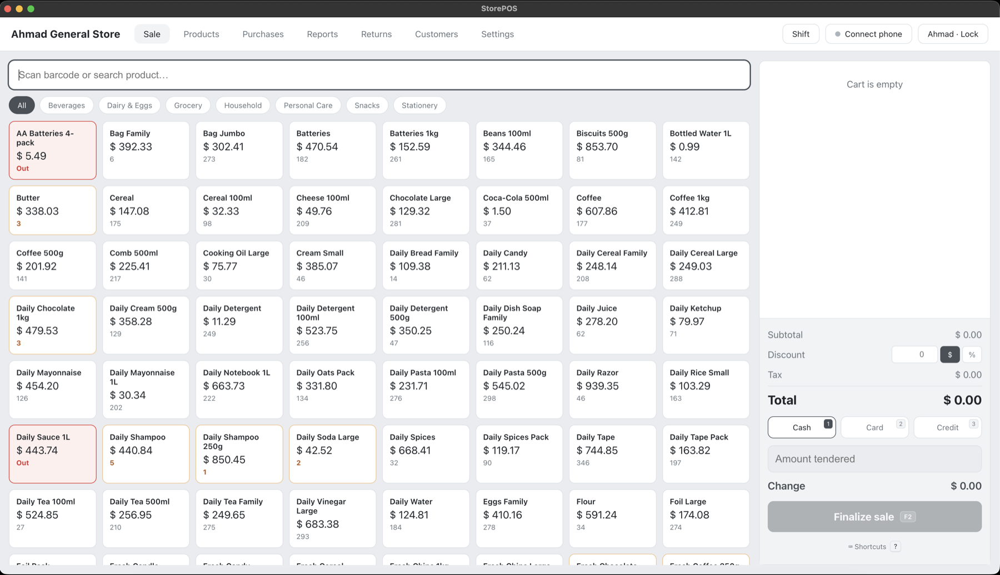
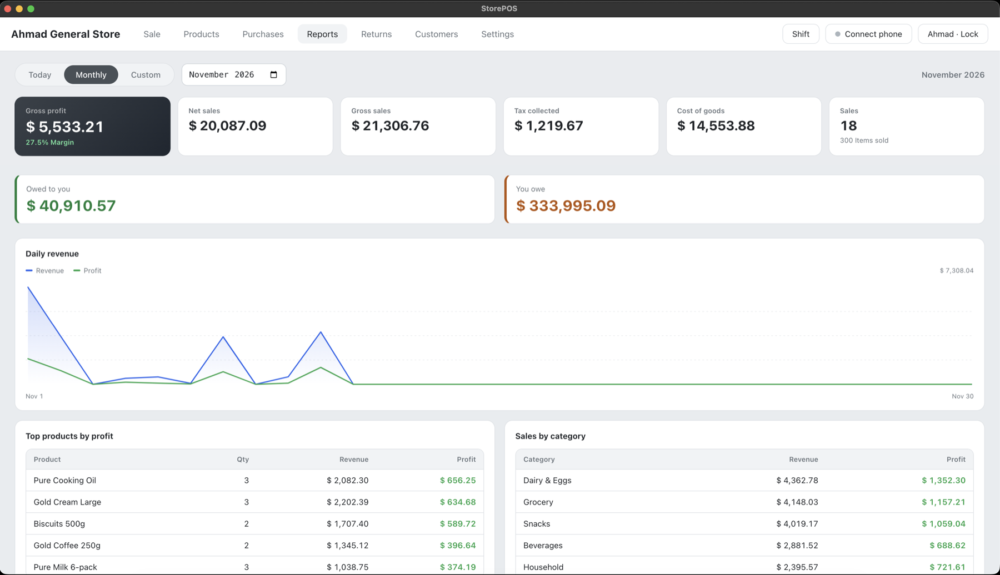
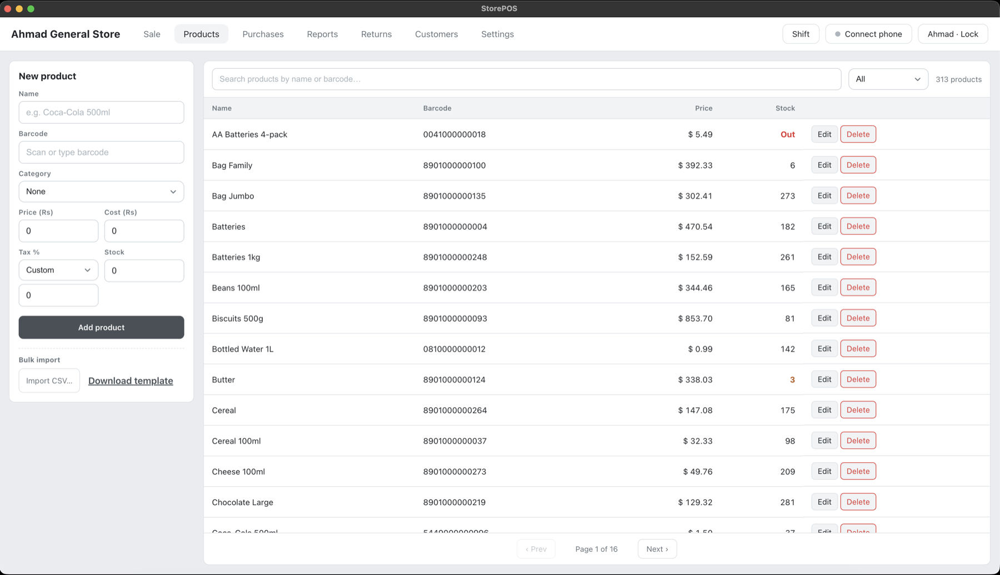
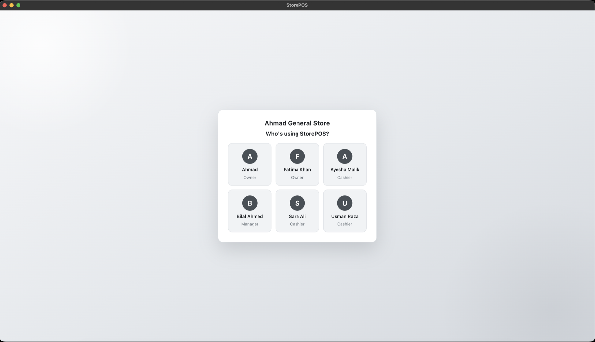
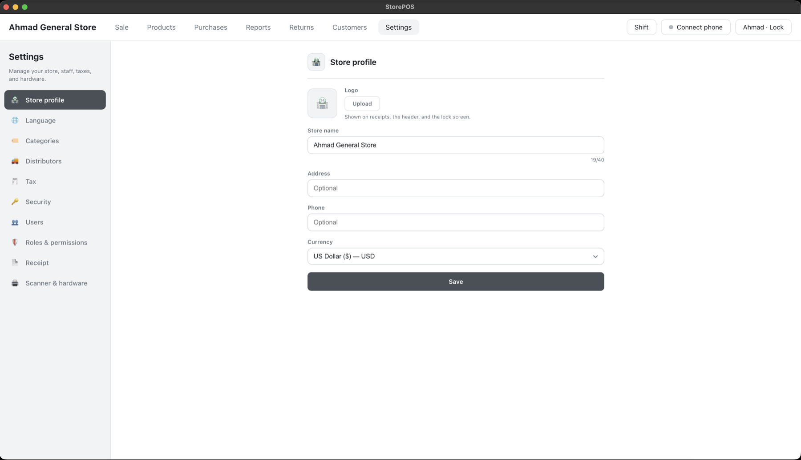
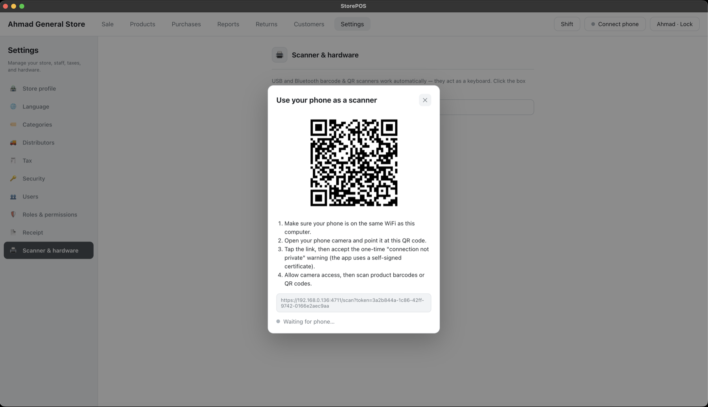

# StorePOS

A simple, **offline-first** point-of-sale desktop app for general stores.
Built with Electron + React + TypeScript and a local SQLite database.

[](https://github.com/AhmadFaraz-crypto/StorePOS/actions/workflows/ci.yml)
[](./LICENSE)

> Works fully offline — the till keeps running with no internet. Cloud sync and
> multi-store management are planned as an optional layer on top (open-core).

## Features

- **First-run onboarding** — pick a language, name your store, choose a currency, and set an
  owner PIN. A lock screen then protects the app on each launch.
- **Settings** — a two-pane page to edit store name/currency, change PIN, switch language,
  manage **categories**, **tax groups**, and **distributors** (full add/edit/delete), configure the
  receipt (header/footer, auto-print), edit **role permissions**, and test a scanner.
- **Sale** — scan a barcode or search, build a cart, apply **line or whole-cart discounts**, take
  cash / card / credit, see change due, finalize. **Keyboard shortcuts** for fast checkout
  (F2 finalize, F3 focus search, F4 amount, Alt+1/2/3 payment method, `?` for the shortcut list).
- **Products** — add/edit products; **categories** (filter on Sale & Products); **bulk import
  via CSV**; **scan-to-add** to build your catalog from the shelf; **color-coded low-stock
  indicators** (amber ≤ 5, red = out).
- **Purchases** — record stock bought from distributors: pick a supplier, add products with
  quantity + cost, which increases stock and updates cost; tracks what you still owe each distributor.
- **Customers & credit (khata)** — sell on credit to a named customer, track each customer's
  running balance, and record payments later with a per-customer history.
- **Staff, roles & permissions** — multiple users with three roles (**owner / manager / cashier**),
  PIN login, and sales attributed to the cashier. Owners edit a **permission matrix** that controls
  what managers and cashiers can access; refunds and discounts above a cashier's rights require a
  **manager/owner PIN** (approvals are enforced in the main process, not just hidden in the UI).
- **Shifts** — open a shift with a cash float and close it for a **Z-report** (expected vs counted
  cash, over/short, totals by payment method).
- **Returns** — look up a recent sale, refund part or all of it (with restock); recorded as a
  negative sale so reports net out automatically.
- **Reports dashboard** — pick a period (today / month / **custom date range**) and see KPI tiles
  (gross profit, margin, net/gross sales, tax, COGS, items sold), a **daily revenue line chart**,
  **receivables & payables**, and paginated breakdowns for **top products**, **sales by category**,
  **sales by cashier**, and **payment methods**.
- **Phone as a scanner** — pair your phone over local WiFi via a QR code and scan barcodes/QR
  with its camera, straight into the cart. No extra hardware, no internet.
- **Multi-language** — English, Urdu, Arabic, Hindi, Spanish, German, and Chinese, with full
  right-to-left layout for Urdu and Arabic; adding another language is one JSON file plus one line.

## Screenshots

<table>
  <tr>
    <td width="50%">
      <br />
      <sub><b>Sale</b> — scan or search, categories, keyboard shortcuts, and cash / card / credit.</sub>
    </td>
    <td width="50%">
      <br />
      <sub><b>Reports</b> — KPIs, daily revenue chart, top products, categories, and receivables / payables.</sub>
    </td>
  </tr>
  <tr>
    <td width="50%">
      <br />
      <sub><b>Products</b> — searchable catalog with pagination, low-stock colors, and CSV import.</sub>
    </td>
    <td width="50%">
      <br />
      <sub><b>Lock screen</b> — pick a user and unlock with a PIN; multi-user with roles.</sub>
    </td>
  </tr>
  <tr>
    <td width="50%">
      <br />
      <sub><b>Settings</b> — store profile, logo, currency, taxes, roles, and hardware in one place.</sub>
    </td>
    <td width="50%">
      <br />
      <sub><b>Phone scanner</b> — pair your phone over local WiFi by scanning the QR, then scan barcodes with its camera.</sub>
    </td>
  </tr>
</table>

## Quick start

Requirements: **Node 20+** and **npm 10+**.

```bash
npm install      # installs deps; rebuilds better-sqlite3 for Electron
npm run dev       # launch the app with hot reload
```

Other scripts:

```bash
npm run typecheck # TypeScript checks
npm test          # unit tests (Vitest)
npm run build     # production build (main / preload / renderer)
npm run dist      # build installers (Windows NSIS / macOS dmg) via electron-builder
```

## How it works

| Layer | What it does |
|-------|--------------|
| `src/main` | Electron main process: window, SQLite (`db.ts`), IPC handlers, the phone-scanner HTTPS/WebSocket server |
| `src/preload` | Context-isolated bridge exposing a typed `window.api` |
| `src/renderer` | React UI — `screens/`, `components/`, `i18n/` |
| `src/shared` | Types shared across all layers (the IPC contract) |

Data lives in a local SQLite database (`storepos.db` in Electron's `userData`
folder). The schema is **sync-ready** from day one — every row has a UUID `id`,
`store_id`, `updated_at`, and soft-delete `deleted_at` — so a cloud sync backend
can be added later without a schema migration.

The phone scanner runs a small local HTTPS + WebSocket server (self-signed cert,
so phones can use the camera). Nothing leaves your network.

## Contributing

Contributions are welcome — see [CONTRIBUTING.md](./CONTRIBUTING.md). All user-facing
text goes through i18n; add new keys to every file in `src/renderer/src/i18n/`.

## Roadmap

1. ✅ Offline sale flow
2. ✅ Catalog & inventory, CSV import, phone scanner
3. ✅ Multi-language (English / Urdu / Arabic / Hindi / Spanish / German / Chinese)
4. ✅ Onboarding wizard + configurable currency + PIN lock
5. ✅ Settings page + silent receipt printing (default printer, dialog fallback) + auto-print
6. ✅ General-POS upgrades: categories · discounts (line + cart) · returns/refunds · multi-tax (tax groups + inclusive pricing)
7. ✅ Purchasing & distributors (stock-in, cost updates, payables)
8. ✅ Customer credit / khata (credit sales, balances, payments, statements)
9. ✅ Multi-user + roles & permissions (owner/manager/cashier, manager-PIN approvals) + shifts / Z-report
10. ✅ Reports dashboard (KPIs, daily revenue chart, custom range, paginated breakdowns)
11. Verticals behind a business-type setting: restaurant (tables/tabs), clothing (variants), pharmacy/grocery (batch/expiry, weighed items)
12. Direct thermal ESC/POS printing + cash-drawer kick
13. CSV / Excel export of reports
14. Packaging + auto-update (electron-updater)
15. Cloud sync backend + multi-store auth + licensing (optional, paid layer)

## License

[MIT](./LICENSE) © StorePOS contributors
